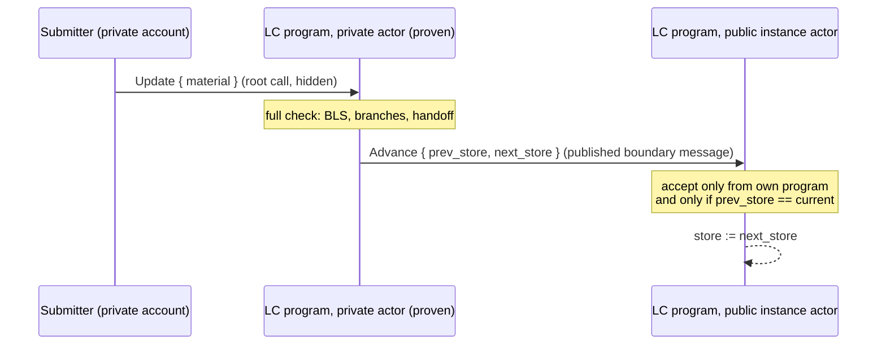

# E1: light-client update in LEZ's proven (private) mode

Question: can a sync-committee update run as a **private actor** of the light-client
program, proven by the submitter, and advance the program's **public** instance?
If yes, what does the chain charge, and what does the submitter pay in proving?

Answer so far: **yes**. The sequencer charges a flat private-transaction fee plus a
small public part, whatever the private part computed. Details and gaps below.

## The mechanism under test



- The same deployed program handles both messages. The privacy circuit proves the private one.
- The sequencer verifies the circuit receipt (flat charge), then runs only `Advance`.

## Results

LEZ `v0.4.0-rc1` (`1806e873`). RISC Zero 3.0.5 guests, `r0vm` 3.0.6. Apple M3 Max, 16 cores, 64 GB.

| Run | What | Result |
|---|---|---|
| E1a, dev | toy update, 12,609,529 private cycles | settles; public part **9,547** cycles |
| E1a, dev | `Advance` from another program | refused: "advance must come from this program" |
| E1a, dev | `Advance` on a stale store | refused: "stale store"; store unchanged |
| E1a, dev | blinded sender | still recognised as its program; settles |
| E1a, dev | same transaction replayed | refused by LEZ (commitment already seen) |
| E1a, **real proof** | toy update, 12.6M cycles | settles with a verified receipt; **895 s** CPU, **13.0 GB** peak, proof **224,813 B** |
| E1b, dev | **real mainnet update** with committee handoff (Sextant vectors, step 1) | settles; private **12,903,333** cycles, public part **14,768** cycles; input 52,079 B stays off chain |
| E1b, **real proof** | the same real update | settles with a verified receipt; **995 s** CPU, **14.1 GB** peak, transaction **227,451 B** |
| E1c, dev | toy update through the block fee path (`settle_transaction`) | exec gas **419,311** = 409,764 flat + 9,547; storage gas **224,063**; **4.19%** of a block's exec, **22.4%** of its storage; base fee 5,146,992 at the floor price |
| E1c, dev | two operators race the same update | loser lands as a **charged revert**: 5,470,616 (its full reserve), store unchanged |
| E1c, **real proofs** | both E1c cases, tiny private burn | identical gas and fees with real receipts; 3 proofs in 699 s (**about 233 s per private transaction** of fixed circuit overhead) |

### Against the public multi-step path

| | Public, 3 transactions (Sextant on v0.3) | Proven, 1 transaction (E1) |
|---|---|---|
| Exec gas per update | about 12.6M (126% of one block, over 3 blocks) | 419,311 to 424,532 (4.2% of one block) |
| Storage gas per update | update material, about 52 KB | 224,063 (the receipt) |
| Base fee at floor prices | about 101M | about 5.1M (**about 20x less**) |
| Job state across transactions | yes | none |
| Submitter hardware | LEZ gas only | a prover: **995 s, 14.1 GB** on a 16-core laptop CPU for a real update (E1b) |

Public-path figures come from Sextant's published measurements, not from this experiment.

### Findings worth keeping

1. Proving cost splits into a fixed part (about 233 s for any private transaction on this CPU) and the update itself (about 760 s more for the BLS check). GPU proving should cut both by an order of magnitude (Tessera reports about 30x on an NVIDIA L4), which is not yet measured here.
2. A canonical sender publishes the submitter's private account ID in the boundary message. Blind it (the test does).
3. A losing racer pays its whole reserve. The update daemon must re-check the instance immediately before submitting (R.9) and keep its reserve tight.
4. LEZ refuses `test-utils` in release builds without debug assertions. `chain_state` tests run with `CARGO_PROFILE_RELEASE_DEBUG_ASSERTIONS=true`.

## What E1 does **not** establish yet

| Gap | Why it matters | How to close it |
|---|---|---|
| **Run on a standalone sequencer node** | Settlement code is covered (`settle_transaction`, the code the sequencer runs). Untested: RPC submission, mempool admission, deployment through the program loader, the node's rules on which public accounts a private transaction may touch. | Needs a Bedrock node. LEZ's resolver found **no prebuilt binary** for the pinned revision and the source build **failed to link** here (Rust 1.99, `rust-lld`). Next try: `bedrock/tools/resolve_bedrock_node_in_docker.sh`, then an integration test modelled on `integration_tests/tests/async_payouts.rs`. |
| GPU proving time | Sets realistic operator cost and update latency. | Metal needs Xcode + Metal toolchain (only Command Line Tools here). Or run on a CUDA box. |
| Lowest-spec machine | P.4 asks for the declared minimum. | Repeat `e1b-prove` on a 16 GB machine. |
| Testnet 0.4 | Delivery target; not released (end of November per roadmap). | Re-run on release. |

## Reproduce

Prerequisites: Rust (rustup), `just`, RISC Zero via `rzup` (`rzup install rust`, `rzup install cpp`, `r0vm` 3.0.x).

```console
cd rfp-021/e1
just            # list recipes
just e1a        # dev mode, about 1 min after the first LEZ build
just e1b 1      # dev mode, real mainnet update step 1 (steps 0 to 3)
just e1c        # dev mode, block fee path and racing copy
just e1a-prove  # real proof, about 15 min CPU
just e1b-prove 1
just e1c-prove  # real proofs with a small private burn (fee is flat in it)
```

Logs land in `results/`. Everything else builds under `.work/` (ignored).

## Layout

| Path | Content |
|---|---|
| `justfile` | all recipes |
| `lez-patch/e1.patch` | the LEZ changes: `lc_spike` guest, `lee` tests (E1a, E1b), `chain_state` tests (E1c) |
| `e1b-guest/` | E1b guest: Sextant's core as a LEZ actor, accelerated `blst` |
| `e1b-pack/` | packs the guest ELF with RISC Zero's v1compat kernel (the form LEZ loads) |
| `vendor/sextant/` | vendored from `edenbd1/lez-sextant` (MIT OR Apache-2.0), see `VENDORED.md` |
| `results/` | logs of the runs above |

## Build notes

- The E1b guest builds with a plain `cargo build` and the rzup toolchains, as Sextant's `build-guests.sh` does. risc0-build drops its `bigint2` signal once `CC_*` is overridden.
- macOS `ar` silently drops RISC-V objects (an empty `libblst.a`). The recipe sets `AR_riscv32im_risc0_zkvm_elf` to the RISC Zero toolchain's `ar`.
- Real proving goes through the prebuilt `r0vm` (no `prove` feature), because building RISC Zero's Metal kernels needs Xcode.
